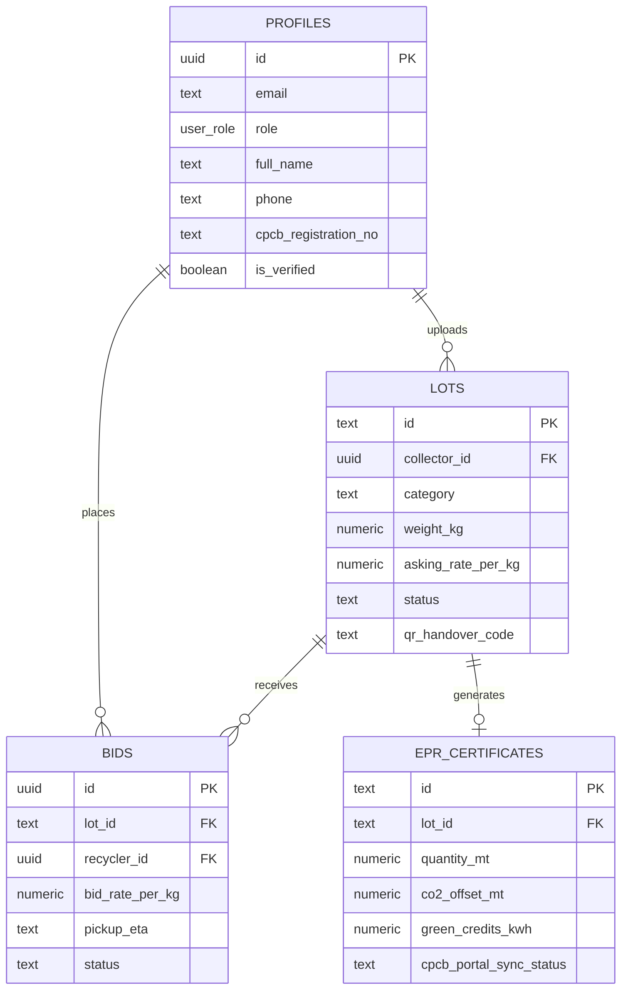

# ♻️ KabadiSetu (कबाड़ी सेतु)
> **Formalizing India's E-Waste Chains via Edge AI, Real-Time Procurement & CPCB EPR Compliance**

[](https://vitejs.dev/)
[](https://nodejs.org/)
[](https://expressjs.com/)
[](https://supabase.com/)
[](https://jwt.io/)
[](https://eprewastecpcb.nic.in/)
[](LICENSE)

---

## 🌐 Live Deployment
- **Production URL**: [https://kabadisetu04.netlify.app](https://kabadisetu04.netlify.app/)
- **Repository**: [https://github.com/pranavb04/KabadiSetu](https://github.com/pranavb04/KabadiSetu)

---

## 📖 Table of Contents
1. [Executive Summary & Problem Statement](#-executive-summary--problem-statement)
2. [The KabadiSetu Solution](#-the-kabadisetu-solution)
3. [Dual-Portal Ecosystem & Key Features](#-dual-portal-ecosystem--key-features)
4. [System Architecture & Tech Stack](#-system-architecture--tech-stack)
5. [Database Schema & Realtime Synchronization](#-database-schema--realtime-synchronization)
6. [Security, Authentication & Role Isolation](#-security-authentication--role-isolation)
7. [Repository Structure](#-repository-structure)
8. [Installation & Local Setup](#-installation--local-setup)
9. [Regulatory Alignment & IP Notice](#-regulatory-alignment--ip-notice)

---

## 🚨 Executive Summary & Problem Statement

India is the **third-largest e-waste producer globally**, generating over **1.71 million metric tonnes** annually. However:
- **Over 95% of collection occurs through the informal sector** (local *kabadiwalas* and scrap aggregators).
- Informal workers face **predatory pricing by middlemen**, lacking knowledge of spot market rates for precious metals.
- Scrap is often processed through **hazardous open-acid leaching and burning**, causing irreversible environmental toxicity.
- Authorized recyclers and brand producers struggle to fulfill statutory **Extended Producer Responsibility (EPR)** quotas mandated by the Central Pollution Control Board (CPCB) due to fragmented supply chains.

---

## 💡 The KabadiSetu Solution

**KabadiSetu (कबाड़ी सेतु)** serves as a **technological bridge** between grassroots informal scrap collectors and CPCB-authorized industrial recyclers.

```
+---------------------------+          +---------------------------+          +---------------------------+
|    Informal Collector     |  ----->  |       KabadiSetu          |  ----->  |    Authorized Recycler    |
|   - AI Camera Scan        |          |  - Fair Price Benchmarks  |          |   - Live Bidding Market   |
|   - Dynamic Valuation     |          |  - Realtime Cloud Sync    |          |   - EPR Credit Ledger     |
|   - Vernacular UI         |          |  - QR Handover Escrow     |          |   - Statutory Audit Manifest |
+---------------------------+          +---------------------------+          +---------------------------+
```

1. **Empowers Collectors**: AI visual scanner identifies component purity (Grade A PCBs, Copper, Li-Ion, Display glass) and guarantees fair, benchmarked remuneration.
2. **Solves Recycler Traceability**: Provides industrial recyclers with direct provenance tracking, high-purity procurement streams, and automated statutory audit manifests.
3. **Automates EPR Compliance**: Calculates real-time green credits, CO₂ offsets, and energy savings for statutory CPCB filings under E-Waste (Management) Rules 2022.

---

## ⚡ Dual-Portal Ecosystem & Key Features

### 1. 📦 Informal Collector Scrap Hub (`/collector-dashboard`)
- **Edge AI Visual Classification**: Real-time object recognition for High-Grade PCBs (96.8% confidence), Copper Wires & Coils (98.4%), Lithium-Ion Batteries (94.2%), and Display Glass (92.1%).
- **Interactive Weight & Dynamic Pricing Engine**: 60fps tactile range slider calculating instant valuations based on official commodity indices.
- **Vernacular Accessibility**: Multilingual interface supporting English, Hindi (हिंदी), Marathi (मराठी), Gujarati (ગુજરાતી), Bengali (বাংলা), Tamil (தமிழ்), and Telugu (తెలుగు).
- **QR Handover Generation**: Generates unique encrypted QR codes for contactless physical material handover and instantaneous UPI escrow disbursement.

### 2. 🏭 Authorized Recycler Procurement Portal (`/recycler-dashboard`)
- **Live Bidding Marketplace**: Real-time multi-lot procurement board with instant filtering by material category, minimum pricing, and geographic radius.
- **Escrow-Backed Bidding**: Bids placed with verified pickup ETAs and automated escrow reservation.
- **CPCB Statutory EPR Ledger**: Calculates environmental impact metrics in real time:
  - Metric Tonnes (MT) of toxic scrap diverted from landfills
  - Metric Tonnes of CO₂ emissions prevented
  - Kilowatt-hours (kWh) of clean grid energy conserved
  - Grams of precious metals (Gold, Silver, Palladium, Copper) recovered
- **QR Verification & Manifest Generation**: One-click QR scanner that marks lots as *Handover Verified* and generates downloadable CPCB-compliant statutory certificates.

---

## 🛠️ System Architecture & Tech Stack

```
[ Frontend: Vite + Vanilla JS Web Components + Modern Flat Design ]
                               │
               ┌───────────────┴───────────────┐
               ▼                               ▼
    [ REST API / WebSocket ]        [ Supabase Cloud Backend ]
  Node.js + Express API Server     - PostgreSQL Realtime Database
  - Bcrypt Password Hashing        - GoTrue Auth (Email Verification)
  - JWT Claims & Role Isolation    - Row Level Security (RLS)
  - Local Persistent Failover      - Auto-Syncing Profile Triggers
```

- **Frontend**: Vanilla JavaScript (ES6+), Vite 8, Lucide Icons, Chart.js, Canvas Confetti, QRCode.js.
- **Styling**: Modern Flat Design System, responsive flex/grid layouts, clean 1px borders, organic elevation drops, and Roboto typography.
- **Backend API Gateway**: Node.js & Express 5 running on port 5000 with CORS and JWT verification middleware.
- **Database & Auth**: Supabase PostgreSQL, GoTrue Authentication with email verification, Row Level Security (RLS), and WebSocket Realtime replication.
- **Security**: Cryptographic JSON Web Tokens (HS256) enforcing strict role segregation.

---

## 🗄️ Database Schema & Realtime Synchronization

The Supabase schema ([`supabase/schema.sql`](supabase/schema.sql)) manages 4 core relational tables:



- **Live WebSocket Replication**: `supabase_realtime` publication enabled on `profiles`, `lots`, `bids`, and `epr_certificates`. When a collector posts a scrap lot, recyclers see it update live without page reloads.

---

## 🔐 Security, Authentication & Role Isolation

1. **Email Verification**: Signups trigger a confirmation email via Supabase Auth. Unverified emails cannot access dashboards.
2. **Strict Role Isolation**:
   - A registered **Informal Scrap Collector** is blocked from entering the Recycler Portal.
   - An **Authorized Recycler** is blocked from entering the Collector Scrap Hub.
   - Attempting cross-portal access is rejected with a `403 Forbidden` security barrier.
3. **Cryptographic JWT Route Guarding**: Client-side router inspects token expiry, claims, and role permissions on every route dispatch.

---

## 📂 Repository Structure

```
KabadiSetu/
├── Prototype/
│   ├── public/                 # Static assets, AI material references & icons
│   ├── server/
│   │   ├── index.js            # Node.js + Express Authentication & Sync API
│   │   └── data/               # Persistent database storage
│   ├── src/
│   │   ├── assets/             # Branding and vector assets
│   │   ├── components/         # Modular Header, Sidebar, and UI Widgets
│   │   ├── data/               # Benchmark rates, translation dictionaries, audit data
│   │   ├── utils/              # Supabase client, Realtime sync, JWT engine, icons
│   │   ├── views/              # View controllers (Landing, Auth, Dashboards, EPR)
│   │   ├── main.js             # Core App orchestrator, router, and event bus
│   │   └── style.css           # Complete Flat Design design tokens and styles
│   ├── supabase/
│   │   └── schema.sql          # Complete PostgreSQL schema, triggers & RLS policies
│   ├── .env.example            # Environment variable template
│   ├── index.html              # HTML5 entry point
│   ├── package.json            # Scripts & dependencies
│   └── vite.config.js          # Vite config with API proxy
└── README.md                   # Project documentation
```

---

## 🚀 Installation & Local Setup

### Prerequisites
- [Node.js (v18 or higher)](https://nodejs.org/)
- npm or yarn
- A free [Supabase Project](https://supabase.com/)

### Step 1: Clone Repository
```bash
git clone https://github.com/pranavb04/KabadiSetu.git
cd KabadiSetu/Prototype
```

### Step 2: Install Dependencies
```bash
npm install
```

### Step 3: Configure Environment Variables
Create a `.env` file in the `Prototype/` directory (or copy from `.env.example`):
```env
# Application
VITE_APP_NAME="KABADISETU"
VITE_PORT=5173

# Supabase Credentials
VITE_SUPABASE_URL="https://your-project.supabase.co"
VITE_SUPABASE_ANON_KEY="your-anon-or-publishable-key"
VITE_JWT_SECRET="your-secure-jwt-secret-key"

# Backend Server
SERVER_PORT=5000
```

### Step 4: Run Database Schema
1. Open your Supabase Dashboard $\rightarrow$ **SQL Editor**.
2. Run the script found in [`supabase/schema.sql`](supabase/schema.sql).

### Step 5: Start the Development Server
In one terminal, start the Express backend server:
```bash
npm run server
```

In a second terminal, start the Vite frontend:
```bash
npm run dev
```

Open **`http://localhost:5173`** in your browser.

---

## 👥 Demo Test Accounts

| Role | Email | Password | Access Rights |
| :--- | :--- | :--- | :--- |
| **Informal Scrap Collector** | `collector@kabadisetu.in` | `collector123` | Collector Scrap Hub, AI Camera Scanner, Lot Uploads |
| **Authorized CPCB Recycler** | `recycler@kabadisetu.in` | `recycler123` | Bidding Marketplace, EPR Impact Portal, QR Handover |

---

## ⚖️ Regulatory Alignment & IP Notice

- **CPCB Regulatory Alignment**: Compliant with Central Pollution Control Board guidelines under India's **E-Waste (Management) Rules, 2022**.
- **Data Protection**: Designed in accordance with India's **Digital Personal Data Protection (DPDP) Act, 2023** for user consent, encryption, and data provenance.
- **Intellectual Property**: All architecture designs, proprietary UI components, and smart pricing algorithms are intellectual property of **KabadiSetu**.

---

*Built with ❤️ for a cleaner, formalized, and sustainable India.*

